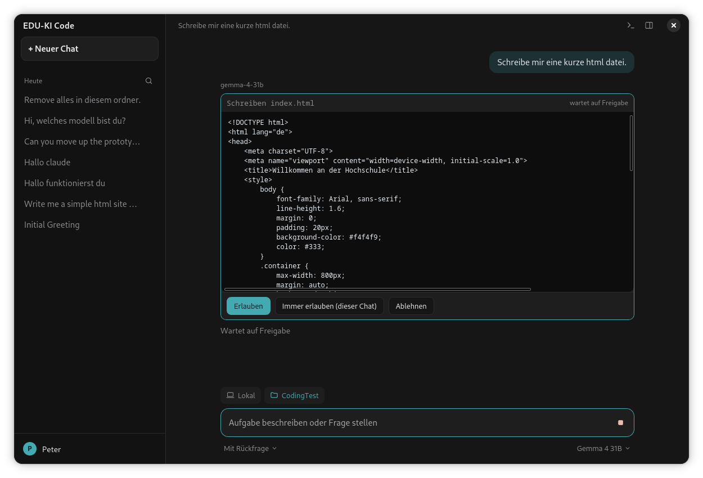
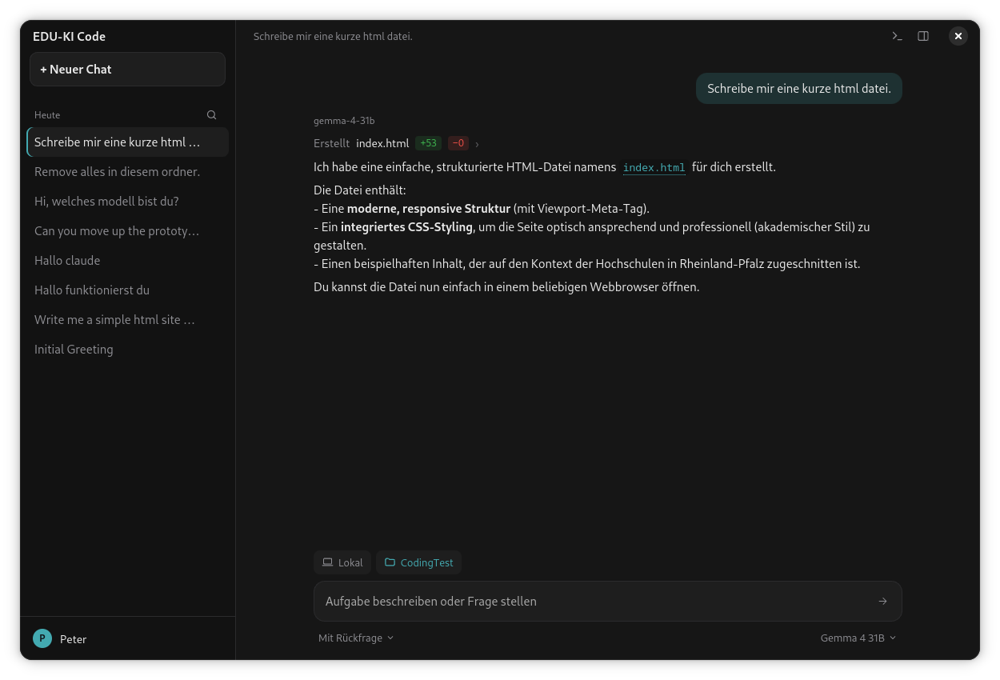

# EDU-KI Code

Desktop-App für KI-Chats mit mehreren Anbietern: Open WebUI hinter Shibboleth-Login (voreingestellt:
EDU-KI-RLP), **DeepSeek Web** (chat.deepseek.com) und beliebige **OpenAI-kompatible APIs** (OpenAI,
OpenRouter, Ollama, LM Studio, andere Open-WebUI-Instanzen). Du meldest dich bei einem oder mehreren
Anbietern an und wählst im Chat aus allen verfügbaren Modellen.

Chat mit Modellauswahl, dazu ein Agent, der in einem Projektordner Dateien lesen und ändern und Befehle
ausführen kann (jeweils mit Rückfrage), mit Datei-Ansicht, HTML-Vorschau und Terminal. Zusätzlich ein lokaler
OpenAI-kompatibler Proxy, den z. B. [opencode](https://opencode.ai) nutzen kann.

Inoffiziell: kein Angebot der Hochschulen. Die Nutzungsbedingungen des Dienstes gelten weiter.

## So sieht es aus



Bevor der Agent eine Datei schreibt oder einen Befehl ausführt, zeigt er den Inhalt und fragt nach.



Nach der Freigabe steht die Änderung als Zeile im Chat (`+53 −0` = hinzugefügte/entfernte Zeilen). Ein Klick
öffnet die Datei rechts im Datei-Bereich.

## Voraussetzungen

- Linux mit Python 3 (getestet mit 3.14; ab 3.10 sollte es reichen)
- `wasmtime` (wird mit den Requirements installiert) für den DeepSeek-Proof-of-Work
- Für das App-Fenster: GTK 4, libadwaita, WebKitGTK 6 und PyGObject.
  - Fedora 43 (diese Pakete sind dort installiert): `sudo dnf install python3-gobject gtk4 libadwaita webkitgtk6.0`
  - Debian/Ubuntu (ab 24.04): `sudo apt install python3-gi gir1.2-gtk-4.0 gir1.2-adw-1 gir1.2-webkit-6.0`
  - Arch: `sudo pacman -S python-gobject gtk4 libadwaita webkitgtk-6.0`
  - NixOS / Nix: nichts davon nötig, siehe [Mit Nix](#mit-nix-nixos-oder-nix-auf-einer-anderen-distribution)

  PyGObject kommt aus den Systempaketen, darum muss `python3` die System-Python sein (nicht pyenv, conda
  o. ä.), sonst sieht die `.venv` es nicht. Fehlt etwas davon, öffnet die App stattdessen ein Chromium-Fenster
  (dafür `chromium`/`google-chrome` oder `.venv/bin/playwright install chromium`) und schreibt in die Konsole,
  was fehlt.

## Einrichten

```bash
git clone git@github.com:pheineke/openWebuiCode.git
cd openWebuiCode
./start.sh
```

`start.sh` legt beim ersten Start die `.venv` an (mit `--system-site-packages`, damit PyGObject sichtbar ist),
installiert die Requirements und startet die App. Es repariert eine `.venv` ohne pip oder ohne
`--system-site-packages` und installiert neu, wenn sich `requirements.txt` oder die Python-Version ändert.
Von Hand geht das so:

```bash
python3 -m venv --system-site-packages .venv
.venv/bin/pip install -r requirements.txt
```

### Mit Nix (NixOS oder Nix auf einer anderen Distribution)

Unter Nix sieht eine `.venv` PyGObject und GTK nicht. Dafür gibt es `flake.nix`: Es holt Python mit allen
Paketen, PyGObject, GTK 4, libadwaita, WebKitGTK 6 und Chromium aus nixpkgs, ohne `.venv` und ohne pip.
`./start.sh` nimmt diesen Weg von selbst unter NixOS und wenn `python3` aus Nix kommt (erzwingen mit
`EDU_KI_NIX=1`, abschalten mit `EDU_KI_NIX=0`). Direkt mit Nix:

```bash
nix run .                    # App-Fenster; Argumente nach --, z. B. nix run . -- --debug
nix run .#cli -- models      # Kommandozeile: serve, login, models, …
nix develop                  # Shell mit allen Abhängigkeiten, darin: python -m edu_ki_proxy app
```

Sind Flakes nicht eingeschaltet, `--extra-experimental-features 'nix-command flakes'` hinter `nix` setzen
(`start.sh` macht das selbst). `nix run .` sieht nur Dateien, die Git kennt: neue Dateien erst mit `git add`
hinzufügen.

## Starten

```bash
./start.sh                  # oder: .venv/bin/python -m edu_ki_proxy app
```

Argumente gehen an die App weiter, z. B. `./start.sh --debug` oder `./start.sh --port 8788`. Das Skript
funktioniert auch über einen Symlink, etwa `ln -s "$PWD/start.sh" ~/.local/bin/edu-ki-code`.

Beim ersten Start siehst du den Anmeldebildschirm mit allen eingerichteten Anbietern.

- **Open WebUI hinter Shibboleth** (EDU-KI-RLP): Die App hat ein eigenes Anmeldeformular, ganz ohne Browser.
  Du wählst deine Hochschule, gibst Benutzername und Passwort ein, und die App spielt den Shibboleth-Ablauf
  selbst durch (Hochschule → SAML → Open WebUI). Benutzername und Passwort gehen nur an deine Hochschule; das
  Passwort wird nicht gespeichert. Fragt die Hochschule zwischendurch etwas (Freigabe deiner Daten an den Dienst,
  Nutzungsbedingungen, ein Einmalcode), zeigt die App diesen Schritt mit dem Text der Hochschule an und du
  entscheidest. Die Liste der Hochschulen kommt vom EDU-KI-Portal. **Stattdessen auf der Webseite der Hochschule
  anmelden** unter dem Formular nimmt den alten Weg über die Webseite im App-Fenster.
- **Open WebUI ohne Shibboleth** meldet sich auf seiner Webseite im App-Fenster an. Der Knopf **Chromium**
  daneben nimmt stattdessen ein Chromium-Fenster.
- **DeepSeek** meldet sich immer in einem Chromium-Fenster an, weil Google und Apple ihre Anmeldung in
  eingebetteten Fenstern ablehnen. E-Mail/Telefon, Google und Apple funktionieren dort.

Läuft eine Sitzung ab, meldet die App dich still neu an: nach einer Hochschul-Anmeldung über deine noch gültige
Sitzung bei der Hochschule (ohne Passwort, solange die Hochschule dich kennt, meist einige Stunden), sonst mit
dem gespeicherten Browserprofil. Klappt das nicht, steht der Anbieter als „Sitzung abgelaufen“ im
Anmeldebildschirm; Hochschule und Benutzername sind dann schon eingetragen. Abmelden: Profil unten
links → Abmelden (alle) oder **Strg+,** → **Anbieter** → Abmelden (einer). Weitere Anbieter hinzufügen:
**Strg+,** → **Anbieter**.

## Benutzen

- **Ordner** (unter dem Eingabefeld, links): Arbeitsordner wählen; im Auswahlfenster legt **Neuer Ordner**
  einen an. Dann darf das Modell dort lesen, ändern und Befehle ausführen. Schreiben und Befehle fragen nach,
  außer du stellst rechts neben dem Modell „Auto“ ein.
- **Unter jeder Nachricht** (beim Darüberfahren): Kopieren; bei deinen Nachrichten **Bearbeiten**, bei Antworten
  **Neu generieren** mit dem gerade gewählten Modell. Beides legt eine neue Version an, mit ‹ › wechselst du
  zwischen den Versionen. **Ab hier neuer Chat** setzt das Gespräch bis zu dieser Nachricht in einem neuen Chat
  fort (bei einer eigenen Nachricht steht sie dort im Eingabefeld); der alte Chat bleibt. Codeblöcke haben oben
  rechts einen Kopierknopf.
- Das Modell lässt sich mitten im Chat wechseln, auch zu einem anderen Anbieter; der Chat bleibt dort
  gespeichert, wo er angelegt wurde.
- **Anhänge**: **+** im Eingabefeld → „Datei oder Bild anhängen“, Dateien ins Fenster ziehen oder einfügen
  (**Strg+V**, z. B. ein Screenshot). Bilder gehen als Bild an das Modell (größere werden auf 1600 px verkleinert); das braucht ein
  Modell mit Bildeingabe, DeepSeek (Web) kann keine Bilder. Text- und Code-Dateien sowie PDF, Word (`.docx`),
  PowerPoint (`.pptx`) und OpenDocument (`.odt`, `.odp`) gehen als Text in die Nachricht. Gescannte PDFs ohne
  Textebene, Excel und alte `.doc`/`.ppt` gehen nicht; die App sagt dann, was stattdessen geht. Ein Klick auf
  einen Anhang zeigt, was das Modell davon bekommt.
- **Websuche**: Unter **+** für den Chat einschalten (Chip über dem Eingabefeld). Vor jeder Antwort sucht Open WebUI
  (z. B. EDU-KI, dort mit you.com) zur letzten Frage, das Modell bekommt die Treffer und zitiert sie mit [1], [2];
  die Quellen stehen unter der Antwort. Geht mit jedem Modell, braucht aber einen angemeldeten Open-WebUI-Anbieter
  mit Websuche. Beim ersten Einschalten zeigt die App den Datenschutzhinweis des Anbieters.
- **Infokarten**: Unter **+** (standardmäßig an, die Wahl gilt pro Chat und als Vorgabe für neue). Das Modell kann
  dann Übersichten, Vergleiche, Zeitleisten oder einfache Diagramme als Karte aus HTML und CSS zeigen; im Text ist
  das ein Codeblock mit der Sprache `card`. Die Karte läuft abgeschottet: ohne JavaScript, ohne Formulare und ohne
  Zugriff aufs Netz (auch Bilder und Schriften von außen werden blockiert), und sie übernimmt die Farben des Themes.
  Oben rechts auf der Karte: HTML anzeigen und kopieren.
- **Skills**: Unter **+** stehen die Skills aus Open WebUI (z. B. EDU-KI: Arbeitsbereich → Skills). Eingeschaltet
  gelten sie für den Chat (als Chip über dem Eingabefeld, × schaltet aus): Ihr Text geht als Anweisung an das
  Modell, auch an Ollama oder DeepSeek. Ein Klick auf den Chip zeigt den Text.
- Oben rechts: **Terminal** und **Dateien** (Code mit Syntaxfarben, bei HTML per Auge-Symbol Vorschau).
- **Projekte** (neben „Neuer Chat“): **+ Neues Projekt** legt ein Projekt mit Namen an, ohne Ordner; Chats kommen über
  **+ Neuer Chat hier** oder ⋯ → **In Projekt verschieben** hinein. Dazu erscheinen die Arbeitsordner, in denen Chats
  laufen, von selbst als Projekte (ein Chat in einem benannten Projekt steht nur dort). Benannte Projekte lassen sich
  über ⋯ umbenennen und löschen; die Chats bleiben dabei erhalten. Projekte speichert die App lokal, für alle Anbieter.
  Bei EDU-KI-Chats merkt sie sich Ordner und Projekt selbst, weil Open WebUIs Chatliste beides nicht enthält.
- **Seitenleiste**: **⋯** am Ende eines Chats (beim Darüberfahren) öffnet **Anpinnen** (oben unter „Angepinnt“),
  **Umbenennen** (auch per Doppelklick; Enter speichert, Esc bricht ab) und **Löschen**. Bei Open-WebUI-Chats gilt
  das auch in dessen Weboberfläche.
- **Strg+K** durchsucht Chats, **Strg+,** öffnet die Einstellungen (Darstellung, Anbieter, Nutzung).

## Anbieter

Unter **Einstellungen → Anbieter** kannst du weitere Dienste hinzufügen:

- **Open WebUI:** Basis-URL der Instanz. Mit Shibboleth davor meldest du dich im eigenen Formular der App an,
  sonst auf der Webseite im App-Fenster.
- **DeepSeek (Web):** keine Basis-URL nötig; Anmeldung bei `chat.deepseek.com` im Chromium-Fenster.
  Chatverläufe werden lokal gespeichert, Open-WebUI-Chats bleiben in Open WebUI. Die Seitenleiste zeigt beide
  zusammen. DeepSeek hat keine offizielle Schnittstelle für das Web-Abo; die App spricht die internen Endpunkte
  der Weboberfläche an. Das kann jederzeit brechen und verstößt womöglich gegen DeepSeeks Nutzungsbedingungen.
- **OpenAI-kompatibel:** Basis-URL inkl. `/v1` und API-Schlüssel, z. B. OpenAI, OpenRouter, Gemini
  (`https://generativelanguage.googleapis.com/v1beta/openai`) oder die DeepSeek-API. Für Ollama/LM Studio auf
  `127.0.0.1` ist kein Schlüssel nötig. Modelle kannst du optional als Komma-Liste eintragen; sonst werden sie
  über `GET /models` geladen. Ändert sich die Basis-URL, wird der gespeicherte Schlüssel verworfen.

Im Chat stehen nur Modelle angemeldeter Anbieter zur Auswahl. Modelle heißen intern `<anbieter-id>/<modell>`,
z. B. `eduki/qwen3.5-397b` oder `deepseek/deepseek-reasoner`. Alte Modellnamen ohne Präfix gehen weiter an den
Standard-Anbieter.

**Tools über den Prompt:** Manche Server reichen die Tools nicht an das Modell weiter. Bei EDU-KI betrifft das
`claude-sonnet-5-rptu`: Claude antwortet dann mit Text wie „**Tool: execute_command**“, statt ein Tool
aufzurufen. Trag solche Modell-IDs in der Anbieter-Karte unter **Tools über den Prompt** ein. Dann beschreibt
der Proxy die Tools im Systemprompt und wandelt die ```` ```tool ````-Blöcke der Antwort in normale Tool-Aufrufe
um (`backends/emulate.py`; DeepSeek arbeitet immer so, und falls DeepSeek doch sein eigenes DSML-Format
schreibt, wird das ebenfalls erkannt). Ohne gewählten Ordner bekommen solche Modelle frühere Tool-Aufrufe im
Chat als Text.

Das erkennt der Proxy auch selbst: Schreibt ein Modell einen Tool-Aufruf als Text (eine Zeile `Tool: list_dir`
und danach JSON) oder lehnt der Anbieter Tool-Ergebnisse ab (z. B. Claude hinter LiteLLM:
`Unexpected role "tool"`), blendet er das aus, schickt die Anfrage noch einmal mit den Tools im Prompt und bleibt
für dieses Modell dabei, bis die App beendet wird. Dauerhaft geht das über den Eintrag oben.

### Aufbau

Jeder Anbieter-Typ ist eine Klasse in `edu_ki_proxy/backends/` (`openwebui.py`, `deepseek.py`,
`openai_compat.py`) mit derselben Schnittstelle (`backends/base.py`): Login-Art, Sitzungsprüfung, Modelle,
Chat im OpenAI-Format und optional ein eigener Chatverlauf. Server, App und CLI kennen nur diese
Schnittstelle; ein neuer Anbieter ist eine neue Datei plus ein Eintrag in `backends/__init__.py`.
`backends/emulate.py` bildet Tool-Aufrufe für Modelle nach, die keine Tools bekommen.
`providers.py` speichert die eingerichteten Anbieter und Sitzungen, `usage.py` das Nutzungsprotokoll,
`trace.py` das Debug-Log.

## Auf einem anderen Rechner arbeiten (SSH)

Chip **Lokal** → **SSH** → **SSH-Verbindung hinzufügen…**: Name, Host (`user@host` oder ein Alias aus `~/.ssh/config`),
Port, Schlüssel und Startordner angeben und mit **Verbindung testen** prüfen. Danach den Ordner auf dem Server
wählen. Agent-Werkzeuge, Datei-Bereich, HTML-Vorschau und Terminal laufen dann auf dem Server, nicht auf deinem Rechner.

- **Anmeldung:** über dein `ssh` mit Schlüssel oder `ssh-agent`. Die Werkzeuge fragen nie nach einem Passwort;
  nur das Terminal kann eines abfragen.
- **Server:** Linux/Unix mit `sh`, `find`, `grep` und GNU-coreutils (`realpath -m`, `timeout`). Der Test meldet, was fehlt.
- **Hostschlüssel:** werden nie abgeschaltet. Für einen neuen Server gibt es die Option „beim ersten Verbinden
  akzeptieren“; ein später geänderter Schlüssel wird weiter abgelehnt.
- Neue Chats starten immer **lokal**. Die Verbindung gehört zum Chat und wird mit ihm gespeichert.
- Gespeichert werden nur Name, Host, Port und Schlüsselpfad (`~/.config/edu-ki-proxy/ssh.json`), keine Passwörter.
  Eine eigene ssh-Konfiguration statt `~/.ssh/config`: `EDU_KI_SSH_CONFIG=/pfad`.
- Wie lokal gilt: Dateiwerkzeuge bleiben im gewählten Ordner (auch über Symlinks, auf dem Server geprüft),
  `bash` ist nicht abgeschottet, die Rückfrage ist der Schutz.

## Mit opencode

Solange die App läuft, ist der Proxy unter `http://127.0.0.1:8787/v1` erreichbar. Ohne App:
`.venv/bin/python -m edu_ki_proxy serve` (Port mit `--port`, dann auch die `baseURL` unten anpassen).
In einer `opencode.json` im Projektordner den Proxy als Anbieter eintragen (Modelle mit `python -m edu_ki_proxy models` auflisten):

```json
{
  "$schema": "https://opencode.ai/config.json",
  "provider": {
    "proxy": {
      "npm": "@ai-sdk/openai-compatible",
      "name": "Lokaler Proxy",
      "options": { "baseURL": "http://127.0.0.1:8787/v1", "apiKey": "unused" },
      "models": {
        "eduki/qwen3.5-397b": { "name": "Qwen 3.5 397B" },
        "deepseek/deepseek-reasoner": { "name": "DeepSeek R1" }
      }
    }
  }
}
```

```bash
opencode -m proxy/eduki/qwen3.5-397b
opencode -m proxy/deepseek/deepseek-reasoner
```

Die Modell-ID im Proxy ist `<anbieter-id>/<modell>`; im opencode-Config ist der Schlüssel unter `models`
genau diese ID, der Provider-Name davor (`proxy`) ist frei wählbar. `python -m edu_ki_proxy models` zeigt alle
IDs. Weitere Befehle:
`login [--provider ID]` (Hochschul-Anmeldung im Terminal; andere Anbieter oder mit `--browser` im
Chromium-Fenster), `providers` (konfigurierte Anbieter),
`tooltest <modell>` (prüft, ob ein Modell Werkzeugaufrufe kann).

## Wo liegen meine Daten?

`~/.config/edu-ki-proxy/` (anderer Ort: Umgebungsvariable `EDU_KI_HOME`). Dort liegen die Anbieter und
Sitzungen (`providers.json`, nur für dich lesbar; bei Hochschul-Anmeldung auch die Cookies der Hochschule für die
stille Neuanmeldung, nie das Passwort), lokale Chats (`chats/`), die Browserprofile für den
Chromium-Login (`browser-profile-<id>/`), die Fenster-Daten mit Einstellungen und das Nutzungsprotokoll.
`state.json` stammt von älteren Versionen und wird nur beim ersten Start übernommen.
Anmeldedaten löschen: in der App abmelden (entfernt auch die Cookies und gespeicherten Sitzungen der Anbieter
im Fenster; nur Dateien zu löschen reicht nicht, die Hochschule könnte dich sonst ohne Passwort wieder anmelden).
Andere Instanz: `EDU_KI_BASE=https://…`. Anderer Browser für den Chromium-Login: `EDU_KI_BROWSER=/pfad`.

## Fehlersuche

- **Debug-Log**: `python3 -m edu_ki_proxy app --debug` (auch `serve --debug` oder `EDU_KI_DEBUG=1`) schreibt
  nach `~/.config/edu-ki-proxy/debug.log` (rotiert bei 10 MB). Pro Chat-Anfrage, unter einer gemeinsamen ID:
  was die App schickt, der Prompt und die Rohdaten von DeepSeek, der vollständige Modelltext, was bei der App
  ankommt, die ausgeführten Tools und die Fehler der App. Das Log enthält Prompts und Dateiinhalte, aber keine
  Sitzungsschlüssel, und ist darum nur auf Wunsch an.
- **Port 8787 belegt** (App startet nicht): `fuser -k 8787/tcp`, dann neu starten.
- **„GTK-Fenster nicht verfügbar“, Chromium-Fenster statt App-Fenster**: PyGObject, GTK 4, libadwaita oder
  WebKitGTK 6 fehlen, Pakete siehe [Voraussetzungen](#voraussetzungen). Steht dort
  `module 'gi' has no attribute 'require_version'`, gibt es zwar einen Ordner `gi` (in Klammern dahinter),
  aber kein PyGObject, meist weil ein anderes Paket nur `gi/overrides/` mitbringt. Dann PyGObject installieren.
  Prüfen: `.venv/bin/python -c "import gi; print(gi.__path__); gi.require_version('WebKit', '6.0')"`.
- **Fenster bleibt leer / 403**: Die App akzeptiert nur Anfragen von `127.0.0.1:<Port>`. Nicht über eine andere
  Adresse oder einen Proxy aufrufen.
- **Modell antwortet nicht mit Werkzeugen**: nicht alle Modelle können das. `qwen3.5-397b` und
  `deepseek-v4-flash` wurden getestet. DeepSeek-Web-Modelle bekommen Werkzeuge über den Prompt beigebracht.
- **DeepSeek: „PoW-Modul konnte nicht geladen werden“**: die App lädt beim ersten Mal
  `sha3_wasm_bg.7b9ca65ddd.wasm` von `fe-static.deepseek.com` und legt sie in `~/.config/edu-ki-proxy/` ab.
  Ohne Internet diesen Schritt einmal mit Verbindung ausführen. Hat DeepSeek eine neue Version veröffentlicht
  (Fehler 404 oder „unbekannte Schnittstelle“), die neue Adresse über `EDU_KI_DEEPSEEK_WASM=https://…` setzen.
- **DeepSeek: „HTTP 403, Bot-Schutz“**: DeepSeeks CDN hat die Anfrage abgewiesen. Das ist keine abgelaufene
  Sitzung; später erneut versuchen oder neu anmelden.
- **Google-Anmeldung meldet „Browser nicht sicher“**: per E-Mail/Telefon anmelden, oder mit
  `EDU_KI_BROWSER=/usr/bin/google-chrome` ein installiertes Chrome statt Chromium versuchen.

## Sicherheit in Kürze

Der Server hört nur auf `127.0.0.1` und prüft Host und Origin, damit andere Webseiten ihn nicht nutzen können
(auch für das Terminal). Die Dateiwerkzeuge bleiben im gewählten Ordner, `bash` ist **nicht** abgeschottet:
Die Rückfrage ist der Schutz, also nur freigeben, was du verstehst. Die HTML-Vorschau läuft in einer Sandbox
ohne Zugriff auf die App.

Gebündelte Bibliotheken (`edu_ki_proxy/static/vendor/`): highlight.js (BSD-3-Clause), xterm.js (MIT), marked (MIT),
DOMPurify (Apache-2.0 oder MPL-2.0).
